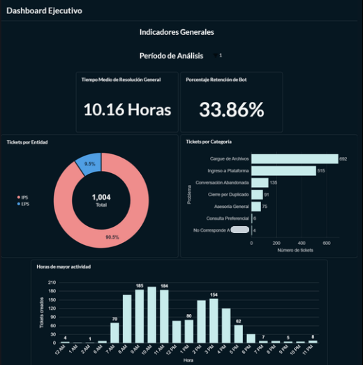
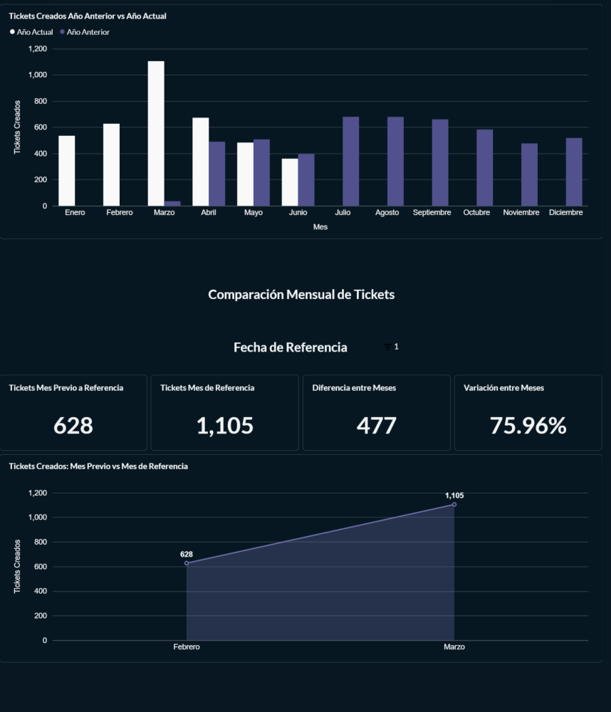
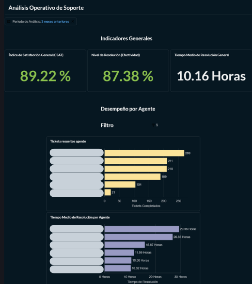
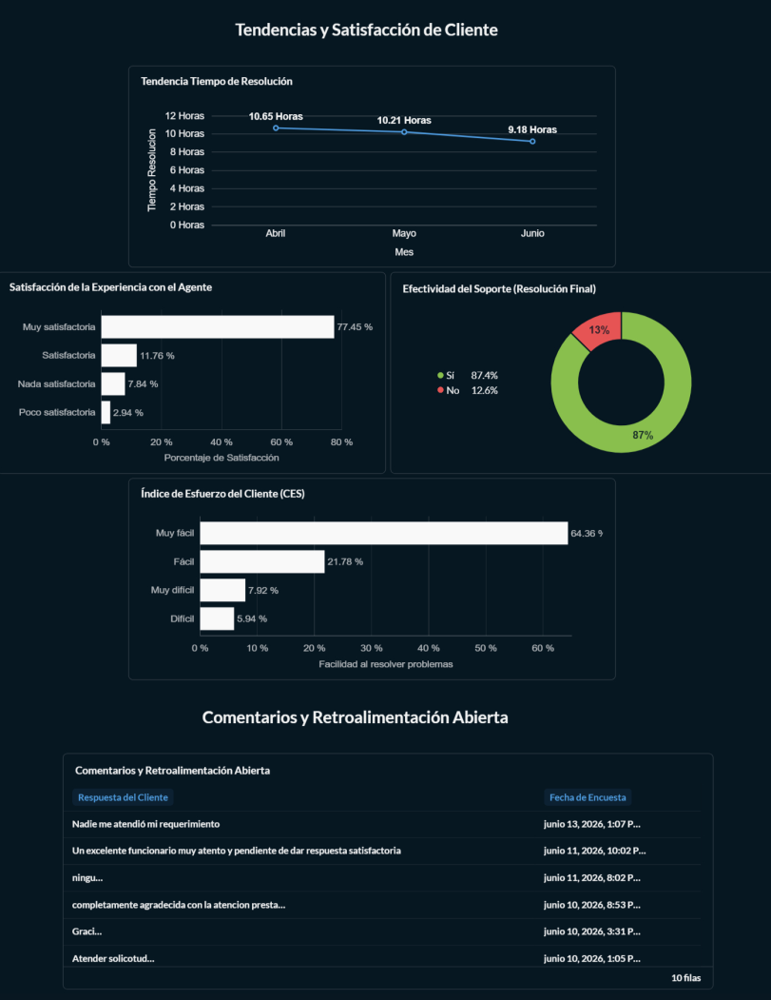

# Dashboards de Soporte con Metabase

Dashboards desarrollados en **Metabase** utilizando una base de datos empresarial para el análisis y seguimiento de indicadores útiles para toma de decisiones en el área de soporte. 

## Descripción

Este proyecto reúne una serie de dashboards creados para facilitar el análisis de información mediante visualizaciones interactivas y métricas de negocio.

Por motivos de confidencialidad, la base de datos original no se incluye en este repositorio. Sin embargo, se comparten las imágenes (PNG) de los dashboards desarrollados con exclusión de los datos personales. 

## Herramientas utilizadas
* **Base de datos:** MySQL
* **BI / Visualización:** Metabase

## Estructura de los Dashboards
| Dashboard | Función |
|-----------|---------|
|**Ejecutivo** | Métricas globales, tendencias, comparativas de periodo, tickets creados, el más general |
| **Operativo** | Desempeño por agente, satisfacción del cliente, más enfocado al rendimiento de soporte |

### Dashboard Ejecutivo

### Dashboard Operativo

## KPIs Implementados 

### Dashboard Ejecutivo 
| KPI | Definición |
|-----|----------------|
| Tiempo Medio de Resolución General| El tiempo medio que se tarda un ticket desde su creación hasta su cierre, sólo incluyendo horas laborales |
| Retención de Bot | `% de tickets resueltos por bot (modified_by_id = 1)` |
| Variación entre Meses | Muestra la variación porcentual de tickets `ROUND(100 * ( conteo_mes_referencia - conteo_mes_previo ) / NULLIF(conteo_mes_previo, 0), 2` (por defecto) entre mes pasado y mes antepasado |

### Dashboard Operativo
| KPI | Definición |
|-----|------------|
| **Índice de Satisfacción General (CSAT)** | Muestra el % de satisfacción en base a `question_id=1` donde la respuesta es `option_selected_id=(1,2)`, lo que significa que la experiencia fue satisfactoria con el asesor |
| **Nivel de Resolución (Efectividad)** | Muestra el porcentaje de resolución de problemas en base a `question_id=2` donde la respuesta es `option_selected_id=5`que significa que se logró resolver el problema de la consulta con el asesor |

## Glosario

| Sigla | Significado |
| ----- | ----------- |
| **EPS** | Entidad Promotora de Salud (las aseguradoras) |
| **IPS** | Institución Prestadora de Servicios de Salud (clínicas, hospitales, laboratorios) |
| **MTTR** | Tiempo medio de resolución |
| **CSAT** | Índice de satisfacción del cliente |

## Hallazgos Destacados 
- **90.5% de los tickets provienen de las IPS** Lo que se ve respaldado por el problema más repetido que es el `cargue de archivos`.
- **Retención de bot:** 33.86%. Lo que significa que 1 de cada 3 tickets los resuelve el bot, alivianando la carga de trabajo humano.
- **CSAT General:** 89.22%. Lo que indica que la mayoría califica la atención como satisfactoria.
- **MTTR General:** 10.16 horas promedio.
- **La tendencia en el tiempo de resolución** va disminuyendo en los últimos meses.

## Consultas SQL
Todas las consultas están en `/sql/` y están optimizadas para:
- Filtros dinámicos de fecha (`{{tickets.created_at}}`)
- Filtros por agente (`{{auth_user.id}}`)

## Contenido del repositorio
* Dashboards en formato de imagen (PNG).
* Visualizaciones orientadas al análisis de datos.
* Indicadores para el seguimiento de información de negocio.

## Habilidades demostradas
* Diseño de dashboards.
* Visualización de datos.
* Construcción de consultas SQL.
* Análisis de indicadores (KPIs).
* Comunicación visual de información.
